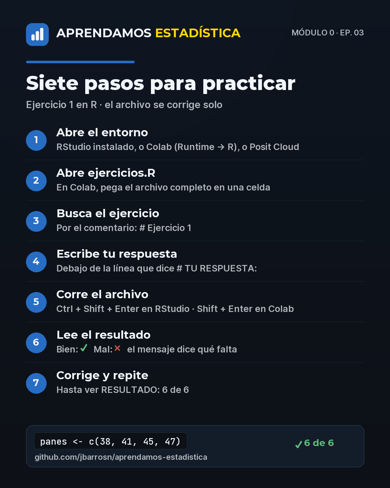

# Actividad · Episodio 3 — Tu primer código en R

**Tiempo estimado:** 15 a 20 minutos.
**Entrega:** captura del resultado final + tu reto en los comentarios del video.

---

## 1. Antes de empezar: elige dónde trabajar

Puedes hacer la actividad en cualquiera de estos tres entornos. Los tres sirven; elige según tu computador.

| Opción | Qué necesitas | Cuándo usarla |
|---|---|---|
| **RStudio instalado** (recomendado) | Instalarlo siguiendo el [episodio 2](../modulo-0/ep02-instalar-r-y-rstudio) | Tienes permisos para instalar programas |
| **Google Colab** | Solo una cuenta de Google | No puedes instalar nada, o usas tablet / computador prestado |
| **Posit Cloud** | Cuenta gratis en <https://posit.cloud> | Quieres ver las mismas cuatro ventanas del video |

El manual paso a paso de Colab y de Posit Cloud está en **[docs/colab.md](colab.md)**, con las diferencias frente a RStudio y los errores típicos.

---

## 2. Qué vas a hacer



Vas a escribir, no a copiar. El archivo trae seis ejercicios y un reto opcional, y **se corrige solo**.

1. Abre [`practica/ep03-primer-codigo/ejercicios.R`](../practica/ep03-primer-codigo/ejercicios.R).
2. Busca el comentario **`# Ejercicio 1`**.
3. Escribe tu respuesta debajo de **`# TU RESPUESTA:`**.
4. Corre el archivo completo:
   - RStudio: **Ctrl + Shift + Enter**
   - Colab / web: **Shift + Enter** en la celda
5. Repite con el ejercicio 2, 3, … hasta el 6.

> **No busques números de línea.** El archivo cambia cada vez que se mejora; la referencia estable es el comentario `# Ejercicio N`. Si alguien te dice «línea 17», puede estar viendo otra versión.

---

## 3. Cómo saber si vas bien

Debajo de cada ejercicio hay un bloque de comprobación. Al correr el archivo, la consola te responde:

- `✓ Ejercicio 1: creaste 'panes' con los cuatro valores` → bien.
- `✗ Ejercicio 1: creaste 'panes' con los cuatro valores` → falta o está distinto.

Al final aparece tu resultado:

```
------------------------------------------------
RESULTADO: 6 de 6
¡Felicidades! Los 6 ejercicios quedaron bien.
```

Si sacas menos, el mensaje te dice qué revisar. Corrige, vuelve a correr y **no sigas** hasta tener el `✓`.

---

## 4. Ojo con el ejercicio 5

Pide usar `+` **como función**:

```r
suma_funcion <- `+`(2, 3)
```

`2 + 3` da el mismo número. El corrector te lo va a aceptar porque solo puede ver el valor, pero **no demuestra la idea del episodio**: que hasta sumar es una función. Si escribiste `2 + 3`, vuelve a hacerlo con los acentos graves.

---

## 5. El reto final

En el último bloque del archivo:

```r
raices <- sapply(panes, sqrt)
```

Ese reto no afecta a los seis ejercicios. **Publícalo en los comentarios del video**, junto con la captura de tu resultado: así se ve que practicaste y no solo que viste el video.

---

## 6. Cómo se califica

| Criterio | Puntos |
|---|---|
| Los seis ejercicios con `✓` | 6 |
| Reto opcional (`raices`) | +1 |
| Explica en un comentario qué hace `<-` frente a `=` | +1 |

El puntaje no es lo importante: si algo quedó en `✗`, el mensaje ya te dijo qué mirar.
